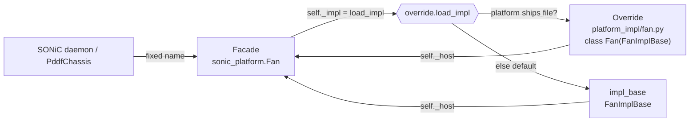

# sonic_platform Architecture (Facade + Impl + Override)

## 1. Why this structure

All Juniper platforms ship **one** shared `sonic_platform` wheel. SONiC daemons
and `PddfChassis` import device classes by **fixed names**
(`sonic_platform.sfp.Sfp`, `sonic_platform.fan.Fan`, ...), so we cannot ship a
different subclass file per platform. Per-platform differences must therefore be
handled at runtime, not by swapping module files.

The restructure splits every device type into three layers:

```
sonic_platform/<kind>.py              Facade   — the fixed public class (Sfp, Fan, ...)
sonic_platform/impl_base/<kind>.py    ImplBase — the default overridable behavior
<module>/<plat>/platform_impl/<kind>.py  Override — optional per-platform behavior
```



### The three layers

| Layer | File | Owns |
|-------|------|------|
| **Facade** | `sonic_platform/<kind>.py` | `__init__`, **all state**, config/JSON parsing, generic internal mechanics (sysfs/gpio/hwmon helpers). |
| **ImplBase** | `sonic_platform/impl_base/<kind>.py` | ONLY the inherited base-class public API (the overridable contract). Reads state and calls mechanics via `self._host`. |
| **Override** | `<module>/<plat>/platform_impl/<kind>.py` | ONLY the handful of methods that genuinely differ on one platform. Subclass of `<Kind>ImplBase`. |

The facade delegates each public method to `self._impl`:

```python
class Fan(FanBase):
    def __init__(self, ...):
        FanBase.__init__(self)
        from sonic_platform.override import load_impl
        self._impl = load_impl("Fan", self)   # override, else FanImplBase
        # ... parse pddf-device.json into state (facade owns config + state) ...

    def get_speed(self):
        return self._impl.get_speed()           # thin passthrough
```

The impl reaches back into facade state and mechanics through `self._host`:

```python
class FanImplBase:
    def __init__(self, host):
        self._host = host
    def get_speed(self):
        pwm = self._host._read_hwmon_pwm_255()  # mechanics live on facade
        ...
```

## 2. When to put a method in the Impl (and when not to)

### Put it in `impl_base/<kind>.py` when:
- It is part of the **inherited base-class (PDDF) public API** — a method a
  platform could conceivably need to override (`get_speed`, `get_presence`,
  `get_status_led`, `get_reboot_cause`, ...).
- It is a public method that **other objects call** on the device (part of the
  contract PDDF/base classes or sibling devices depend on).

That is the whole rule: **the impl holds the inherited public API only.** If a
platform genuinely diverges on internal behavior, expose it as a proper method
the facade delegates to (`def foo(self): return self._impl.foo()`), giving it a
default that matches current behavior. Generic internal helpers always stay on
the facade and are reached from the impl via `self._host`.

### Do NOT put it in the impl (keep it on the facade) when:
- It is `__init__` or any **config/JSON parsing**. The facade parses
  `pddf-device.json` into state in its own `__init__`.
- It holds or initializes **state** (`self._fan_cfg`, cached sysfs paths, GPIO
  pins, etc.). All state lives on the facade.
- It is **generic internal mechanics** shared by every platform — sysfs/hwmon/
  gpio access helpers (`_read_hwmon_pwm_255`, `_resolve_pwm_path`,
  `_get_rpm_alarm_range`). These stay on the facade and are reached via
  `self._host`.

> Rule of thumb: **Overridable contract → impl. State + mechanics → facade.**
> If a platform would never want to change it, it does not belong in the impl.

## 3. When and where to create an Override

### Where
Source lives in the **platform module** folder, one file per device type:

```
<module>/<plat>/platform_impl/<kind>.py
```

e.g. `qfx5250/platform_impl/chassis.py`. The file defines a class named exactly
after the kind and subclasses the matching `*ImplBase`:

```python
# qfx5250/platform_impl/chassis.py
from sonic_platform.impl_base import ChassisImplBase

class Chassis(ChassisImplBase):          # class name == kind
    def get_reboot_cause(self):          # override ONLY what differs
        val = self._host._devmem_read(0x...)   # facade mechanics via self._host
        ...
```

`debian/rules` copies `platform_impl/` into the installed
`/usr/share/sonic/device/<plat>/pddf/platform_impl/`, where
`override.load_impl()` finds it. The filename is the `snake_case` of the kind
(`Sfp` → `sfp.py`, `VoltageSensor` → `voltage_sensor.py`); the all-lowercase
form is also accepted as a fallback.

### When to create one
Create an override **only** when a platform's behavior for a specific method
genuinely differs from the shared default and **cannot** be expressed as data in
`pddf-device.json`.

- **Prefer JSON first.** The facade reads all platform-specific *values* from
  `pddf-device.json` (RPM ceilings, GPIO offsets, LED patterns, hwmon names,
  ...). A new platform with only different *values* needs **zero** Python — just
  edit the JSON. Do **not** write an override for this.
- **Write an override only for different *logic*** — e.g. a platform reads its
  reboot cause from a CPLD register instead of the default source.

### When NOT to create one
- The difference is just a value → put it in `pddf-device.json`.
- The behavior matches the default → ship nothing; the loader falls back to
  `<Kind>ImplBase` automatically.
- You only need part of a device changed → override **only** the differing
  methods; everything else stays on the shared `*ImplBase`.

A platform ships only the override files it needs. Ship none, and every device
uses the shared defaults with identical behavior.

## 4. Extra Info

- **Never** do a top-level `from sonic_platform.impl_base.X import ...` in a
  facade — it force-loads `impl_base/__init__` (every impl) before test stubs
  exist. Use a **local/lazy import inside a method** (as `load_impl` does).
- Facades extending **abstract** bases (sensor, voltage/current sensor,
  asic_thermal, sfp_thermal, fan): any public method not delegated raises
  `NotImplementedError`. Always verify **every impl public method has a facade
  delegate**, and that **no original public method was dropped**.
- Generic internal mechanics live on the facade and are reached from the impl
  via `self._host`.
